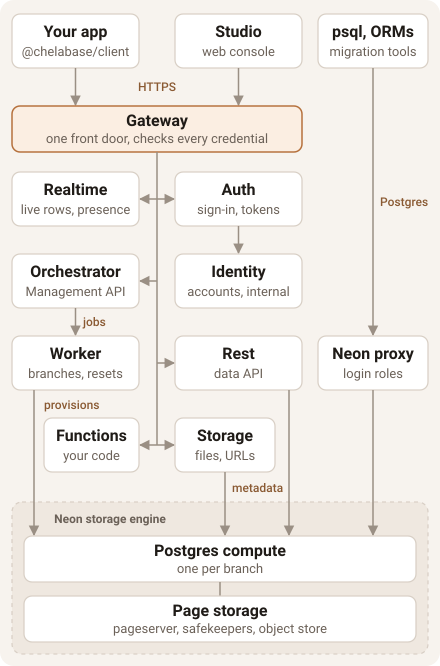

# Chelabase

Chelabase is an open-source Postgres platform: databases with copy-on-write branches, a typed data API, login roles, auth for your app's users and a web console, built on Neon's storage engine. You can self-host it today with Docker Compose; a hosted version is planned.

> [!WARNING]
> **Alpha.** Chelabase is early, pre-release software and not ready for production data. Expect
> breaking changes between versions, rough edges and security issues no one has found yet. Run it on
> data you can afford to lose, and [report what breaks](https://github.com/chelabase/chelabase/issues).

<!-- Static badges: the repo is private and has no release or CI yet. When the repo is public, the
first release is cut and CI (#7) exists, swap in dynamic release and CI badges. -->
[](LICENSE)
[](infra/neon/README.md)
[](apps/docs/content/docs/self-hosting/install.mdx)
[](SECURITY.md#supported-versions)

## How it works

Chelabase is a set of open-source services behind one gateway. Each database is a Postgres
compute on Neon's storage engine, so branches are copy-on-write and can be made or restored at a
point in time.

<p align="center">
  
</p>

- **[Gateway](apps/docs/content/docs/architecture/gateway.mdx)** is the single front door. It checks every request's credential (a member's token or a data API key) and forwards it to the right service.
- **[Studio](apps/docs/content/docs/using/studio.mdx)** is the web console: projects, databases, branches, the table and SQL editors, keys, members and app users.
- **[Orchestrator](apps/docs/content/docs/architecture/orchestrator.mdx)** serves the Management API (`/v1`), decides who may do what and keeps the platform's own state. The **Worker** runs its jobs: creating, branching, resetting, restoring, merging and deleting databases.
- **[Rest](apps/docs/content/docs/architecture/data-api.mdx)** is the data API. It turns a JSON query into SQL and runs it as the key's role, so Postgres row-level security decides what each caller sees.
- **[Auth](apps/docs/content/docs/architecture/app-users.mdx)** signs in Studio members and your app's own users (sign-up, sign-in, sessions), with helpers for RLS policies.
- **[Identity](apps/docs/content/docs/architecture/identity.mdx)** holds every account, Studio members and each project's app users, on [Better Auth](https://www.better-auth.com). It is internal only: nothing outside the stack reaches it.
- **[Realtime](apps/docs/content/docs/architecture/realtime.mdx)** pushes live rows and presence to Studio over a WebSocket.
- **[Neon](apps/docs/content/docs/architecture/neon.mdx)** stores the data. Postgres clients connect through its proxy with [login roles](apps/docs/content/docs/using/login-roles.mdx), whose credentials are encrypted and can be shown again.

The [architecture docs](apps/docs/content/docs/architecture/index.mdx) go deeper.

### Client libraries

| Language | Package | What it covers | Status |
|---|---|---|---|
| TypeScript | [`@chelabase/client`](packages/client) | Data API queries with generated types, and app-user auth (`db.auth`) | In this repository; not on npm yet |
| TypeScript | [`@chelabase/management-client`](packages/management-client) | The Management API, as TanStack Query hooks (what Studio uses) | In this repository; not on npm yet |
| Any | Your Postgres driver | Direct SQL over the Postgres protocol | Works today |
| Any | HTTP | The [data API](apps/docs/content/docs/using/data-api/index.mdx) and Management API, described in [`openapi/`](openapi/) | Works today |

## Self-hosting

Self-hosted Chelabase runs on one machine with Docker Compose.

### Requirements

- Docker Engine 26.0 or newer (the install mounts volume sub-paths).
- Docker Compose 2.30 or newer. Check with `docker compose version`.
- A checkout of this repository, for `infra/compose`.

Running Chelabase needs nothing else on the host. The [Install](apps/docs/content/docs/self-hosting/install.mdx#requirements) page lists what the machine needs.

### Install

```bash
git clone https://github.com/chelabase/chelabase.git
cd chelabase/infra/compose
cp .env.example .env
docker compose up -d --wait
```

The defaults run on one machine and serve Studio at <http://studio.chelabase.localhost:8000>.

> [!WARNING]
> **Claim the instance before you expose the host.** A new instance has no admin: the first account that signs up with the setup code becomes the admin of the whole instance. The gateway is published on `127.0.0.1` only by default. Keep it that way until you have claimed it.

1. Read the setup code (`Setup code: XXXX-XXXX-XXXX-XXXX-XXXX`):

   ```bash
   docker compose logs init-secrets
   ```

2. Open <http://studio.chelabase.localhost:8000>, choose **Sign in**, then **Create account**, and enter the code. You are now the instance's admin.

After the claim, sign-up is closed: you invite everyone else, or switch open sign-up on and approve requests.

The [Install](apps/docs/content/docs/self-hosting/install.mdx) page covers the rest: the settings, choosing your own secrets, your own domain with TLS behind a reverse proxy ([Hosts](apps/docs/content/docs/self-hosting/hosts.mdx)), email (SMTP), upgrades, and stopping or uninstalling.

## First database

Once you're signed in to Studio:

1. **Create a database.** Open the **default** project (you can rename or delete it later in its settings) or choose **New project**, then add a database to it. Wait until it shows as ready; the first one takes longer while the worker pulls the compute image.
2. **Add a table.** Open the database's **SQL** editor and run:

   ```sql
   create table todos (
     id bigint generated always as identity primary key,
     title text not null,
     done boolean not null default false
   );
   ```

3. **Get a key and your types.** Open the database's **Data API** view. Under **Secret keys**, choose **Create key** and save it (it is shown only once). Then choose **Download types** to save `db.ts`.
4. **Query it from your server:**

   ```ts
   import { createClient } from "@chelabase/client";
   import { type Database, types } from "./db";

   const db = createClient<Database>({
     url: "http://api.chelabase.localhost:8000",
     key: process.env.CHELABASE_DATA_KEY!, // the secret key, chk_sec_…
     types,
   });

   await db.from("todos").insert([{ title: "Try Chelabase" }]);
   const open = await db.from("todos").select("id", "title").where({ done: false });
   ```

That's it. A few things to know:

- **Secret keys stay on servers.** For browser code, use the database's public key (`chk_pub_…`, shown in the same view) and turn on row-level security for the tables it can reach.
- **`@chelabase/client` isn't on npm yet.** Add it from this repository as `"@chelabase/client": "workspace:*"`. The types are optional: `createClient({ url, key })` works untyped.
- **Using Postgres directly?** Migrations, ORMs and `psql` connect with the credentials in the database's **Connection details**.

The [Quickstart](apps/docs/content/docs/using/quickstart.mdx) covers each step in more detail, including fetching types in a build step and connecting over Postgres.

## Documentation

The docs are in this repository, under [`apps/docs/content/docs/`](apps/docs/content/docs/). Start with the [Introduction](apps/docs/content/docs/index.mdx).

- **Using:** the [Quickstart](apps/docs/content/docs/using/quickstart.mdx), [projects and databases](apps/docs/content/docs/using/projects-and-databases.mdx), [branches](apps/docs/content/docs/using/branches.mdx), [login roles](apps/docs/content/docs/using/login-roles.mdx), the [data API](apps/docs/content/docs/using/data-api/index.mdx), the [TypeScript client](apps/docs/content/docs/using/client/index.mdx), [app users](apps/docs/content/docs/using/app-users/index.mdx), [members and invites](apps/docs/content/docs/using/members-and-invites.mdx) and [Studio](apps/docs/content/docs/using/studio.mdx). The rest is in [`using/`](apps/docs/content/docs/using/).
- **Self-hosting:** [Install](apps/docs/content/docs/self-hosting/install.mdx) and [Hosts](apps/docs/content/docs/self-hosting/hosts.mdx).
- **Reference:** the [error codes](apps/docs/content/docs/reference/errors.mdx) and the [access per route](apps/docs/content/docs/reference/access.mdx). The management and data API references are generated from the OpenAPI documents in [`openapi/`](openapi/).
- **Architecture:** [how the parts fit together](apps/docs/content/docs/architecture/index.mdx): the gateway, Studio, the data API, Neon storage and [security](apps/docs/content/docs/architecture/security.mdx).

## Contributing

To work on Chelabase itself, see [CONTRIBUTING.md](CONTRIBUTING.md).

## Security

Report vulnerabilities privately, as [SECURITY.md](SECURITY.md) describes.

## Contact

[hello@chelabase.com](mailto:hello@chelabase.com). For bugs and feature requests, open a GitHub issue.

## License

[Apache-2.0](LICENSE).
